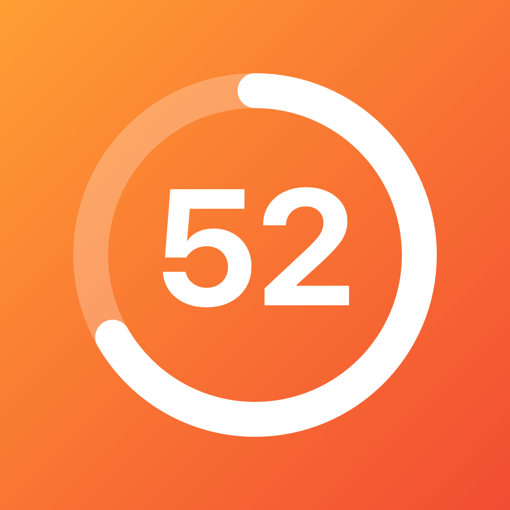

<div align="center">
  

  <h1>Countdown</h1>
  <p><b>A minimal, native iOS Home Screen widget for tracking the days until what matters next.</b></p>

  <p>
    
    
    
  </p>
</div>

<br />

## Overview

**Countdown** brings a clean, Apple-inspired countdown experience directly to your iPhone Home Screen. Designed with SF Pro Rounded typography, subtle spring animations, and a dynamic progress ring, it blends seamlessly into both Light and Dark Mode.

---

## Features

- **Apple-Native Design** — High-contrast rounded typography, clean system background adaptation, and a signature orange accent ring that fills as your target date approaches.
- **Smooth Transitions** — Numeric rolling transitions (`.numericText`) and spring-animated ring progress when the widget timeline refreshes.
- **Dual Configuration**
  - **In-App Editor:** Tap the widget to open the companion app, set a custom title, and pick a target date using the native graphical calendar.
  - **Direct Widget Settings:** Long-press any widget and tap **Edit Widget** to toggle *Use App Settings* off and configure an independent Month, Day, Year, and Label per widget instance.
- **Optional Title Label** — Leave the title blank for a pure, distraction-free day counter.
- **Automatic Daily Refresh** — Timeline updates automatically just after midnight every day.
- **Small & Medium Families** — Tailored layouts for both `.systemSmall` and `.systemMedium` widget sizes.

---

## Architecture

| Component | Technology | Purpose |
| :--- | :--- | :--- |
| **Companion App** | `SwiftUI` · `NavigationStack` | Graphical `DatePicker` and title form that writes to shared storage and triggers `WidgetCenter.shared.reloadAllTimelines()`. |
| **Widget Extension** | `WidgetKit` · `AppIntentTimelineProvider` | Calculates remaining calendar days from the start of today to the target date and schedules midnight refreshes. |
| **Per-Widget Config** | `AppIntents` (`WidgetConfigurationIntent`) | Provides dropdown selectors (`Month`, `Day`, `Year`), custom `Label`, and the `Use App Settings` toggle. |
| **Shared Storage** | `UserDefaults` (App Group) | Syncs the selected target date and title between the main app and the widget extension. |

---

## Getting Started

### Requirements
- **Xcode** 15.0 or later
- **iOS** 17.0 or later

### Setup

1. **Clone the repository**
   ```bash
   git clone https://github.com/Udhayakumar-Velou/countdown-widget.git
   cd countdown-widget
   ```

2. **Open in Xcode**
   Open the `.xcodeproj` file in Xcode.

3. **Configure Signing & App Groups**
   - Select both the main app target and the `CountdownExtension` target under **Signing & Capabilities**.
   - Choose your **Team** and set a unique **Bundle Identifier** for each target.
   - Ensure both targets have the **App Groups** capability enabled and share the same group identifier.

4. **Build & Run**
   Select your iPhone or Simulator and press **Cmd + R**. Long-press the Home Screen, tap **+**, and add **Countdown**.

---

## Usage

1. **Edit via the App:** Tap the widget on your Home Screen, type a custom title (or leave it empty), select your target date on the calendar, and tap **Save**.
2. **Edit on the Home Screen:** Long-press the widget → **Edit Widget**. Keep **Use App Settings** enabled to mirror the app, or disable it to pick a standalone date and label for that specific widget.

---

## License

Available for personal and educational use.
